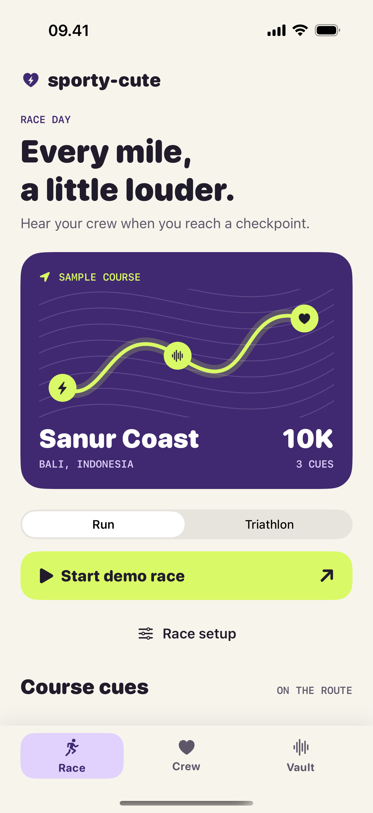
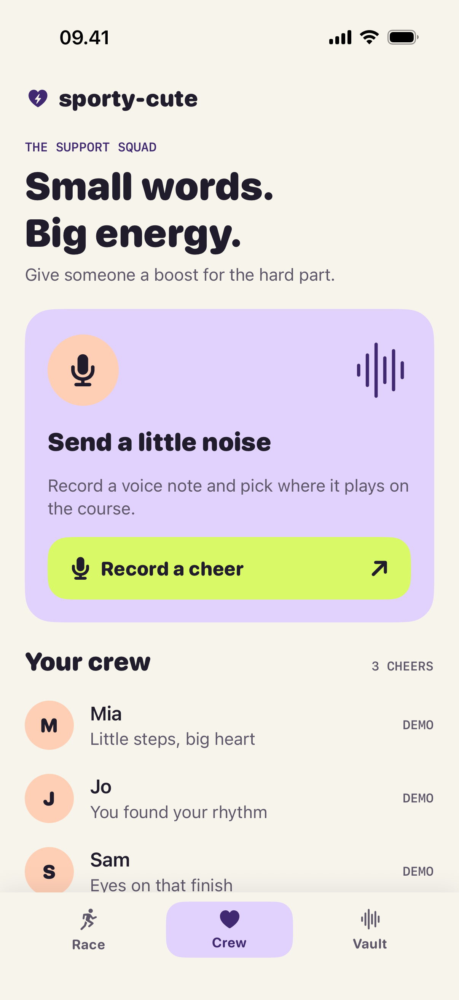
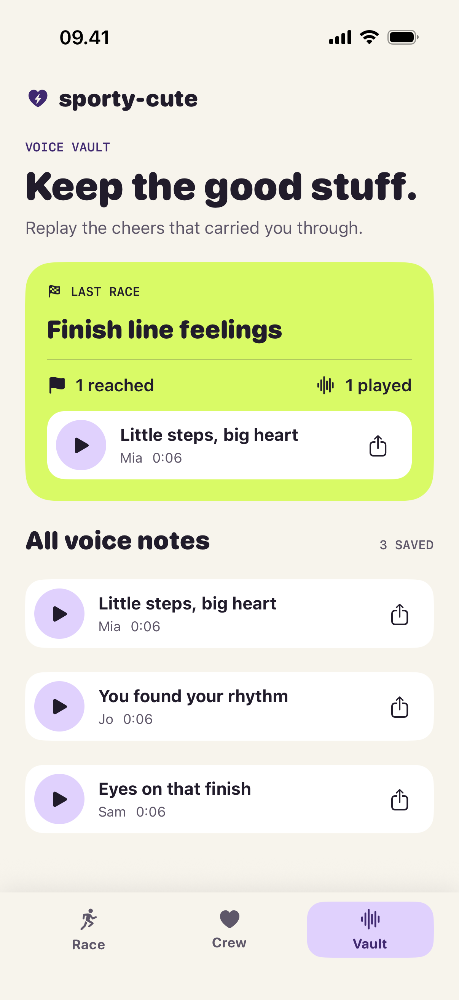

# sporty-cute

A native iPhone portfolio app for endurance athletes. Record a cheer, pin it to a course checkpoint, and hear it during a race. The Voice Vault keeps the cheers and the latest race recap together.

## Screenshots

<p>
  
  
  
</p>

## Run it

Open `SportyCute.xcodeproj` in Xcode 26 or later, select **SportyCute** and an iPhone simulator running iOS 17 or later, and press **Run**. The project file is checked in. No package installation or credentials are needed.

1. Tap **Start demo race**, then **Reach next checkpoint** to hear a bundled sample cheer.
2. Finish the race to open the replay in **Vault**. Use the share button to export an individual `.m4a`.
3. Open **Crew** to record a cheer and assign it to a checkpoint. The app requests microphone access when you start recording.
4. Select **Triathlon** to demo the Swim → Bike → Run sequence with the T1 and T2 buttons.

For outdoor use, edit the checkpoint coordinates under **Race setup**, select **GPS**, and start the race from the foreground. A cue is eligible when an accurate, recent location fix is within 60 meters. Each checkpoint fires once per race. Optional T1 and T2 Bluetooth LE beacons use distinct 128-bit advertised service UUIDs. Only the next transition is monitored. Manual transitions are available throughout.

## Architecture

| Folder | Responsibility |
| --- | --- |
| `SportyCute/App` | Composition root and tab navigation |
| `SportyCute/Features/Race` | Race preparation, live race UI, and `RaceViewModel` |
| `SportyCute/Features/Crew` | On-device recording UI and checkpoint assignment |
| `SportyCute/Features/Vault` | Playback, recording state, recap, and `VoiceVaultViewModel` |
| `SportyCute/Domain` | Value types for checkpoints, race progression, transitions, and cheers |
| `SportyCute/Services` | Core Location, Core Bluetooth, AVFoundation, and local persistence |
| `SportyCute/Design` | Palette, reusable controls, and the schematic course illustration |

SwiftUI observes main-actor view models. They translate user actions and framework callbacks into state changes. The app stores recordings as AAC in `.m4a` files and saves metadata atomically in Application Support. AVFoundation requests audio ducking while a cheer plays and releases the session afterward. Race and vault diagnostic events use `Logger` categories under `indie.sportycute.app`.

## Tests

Use **Product → Test** in Xcode or run:

```sh
xcodebuild -project SportyCute.xcodeproj -scheme SportyCute \
  -destination 'platform=iOS Simulator,name=iPhone 17 Pro' \
  -parallel-testing-enabled NO test
```

Choose a simulator installed on your machine. Unit tests cover coordinate filtering, deduplication, transition order, replay order, and persistence. UI tests exercise a demo race through replay and the triathlon transition flow.

## Portfolio scope

The app runs offline. The three sample voices are synthesized. The course illustration is schematic. GPS and Bluetooth are designed for an active race started in the foreground. Voice capture happens in-app, and the share sheet exports individual notes. Remote crew recording, cloud storage, server-side loudness normalization, subscriptions, and distribution through TestFlight or the App Store are outside this portfolio build.
